# shopping-mall-project

JSP/Servlet과 Oracle DB를 활용한 쇼핑몰 웹 프로젝트입니다.

## 제작 기간 (2026. 07. 11 ~ 2026. 09. 12)

## 프로젝트 소개

고등학교 2학년 때 Java와 JSP를 사용해 만든 온라인 쇼핑몰 ILLYA입니다.

회원가입과 로그인, 상품 조회와 검색, 장바구니, 주문 기능을 구현했습니다. 회원 정보와 상품 정보, 게시글은 Oracle Database에 저장하며, 일반 회원과 관리자 계정의 권한을 구분했습니다.
- 추가 작업으로 시연 영상이랑 디자인이 조금 다릅니다. (거의 비슷합니다)
## 사용 기술 및 도구

| 구분 | 사용 기술 |
| --- | --- |
| 웹 화면 | HTML, CSS, JavaScript |
| 서버 개발 | Java, JSP, Servlet |
| 데이터베이스 | Oracle Database |
| DB 연동 | JDBC, PreparedStatement |
| 실행 환경 | Apache Tomcat 9 |
| 라이브러리 | JSTL, COS |
| 상태 관리 및 요청 처리 | Session, Cookie, Servlet Filter |

## 주요 기능

| 기능 | 설명 |
| --- | --- |
| 회원 관리 | 회원가입, 로그인, 로그아웃, 회원 정보 조회 및 수정, 회원 탈퇴 |
| 입력값 검사 | 회원가입 입력값 확인, 아이디와 이메일, 전화번호 중복 검사 |
| 상품 조회 및 검색 | 전체 상품과 상세 정보 조회, 상품명과 설명, 제조사, 카테고리, 상품 ID로 검색 |
| 관리자 기능 | 관리자 권한 확인, 상품 등록과 수정 및 삭제, 상품 이미지 업로드, 가격과 재고 관리 |
| 장바구니 | 상품 추가, 수량 변경, 개별 삭제, 전체 비우기, 합계 계산 |
| 주문 | 배송 정보 입력, 주문 상품과 총금액 확인, 주문 수량과 재고 확인, 주문 완료 시 재고 차감 |
| Q&A 게시판 | 게시글 작성과 조회, 검색, 페이징, 작성자 본인의 글 수정 및 삭제, 조회수 중복 증가 방지 |
| 기타 | 한국어와 영어 전환, UTF-8 인코딩 필터, 요청 정보 수집, 404와 500 오류 페이지 |

## 시연 영상

## 주요 화면

### 1. 메인 화면

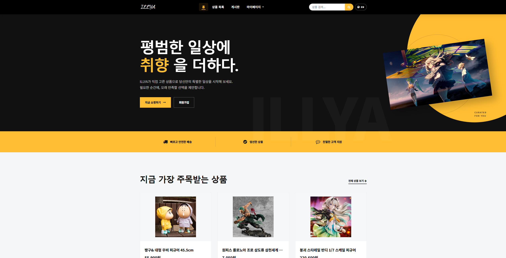

쇼핑몰의 전체 디자인과 주요 메뉴를 보여주는 화면입니다.

### 2. 상품 목록 및 검색 결과

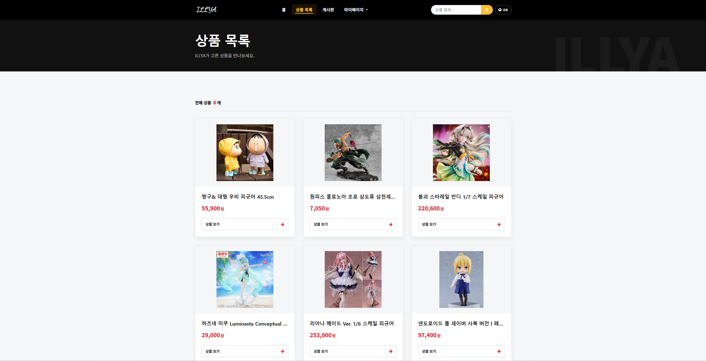

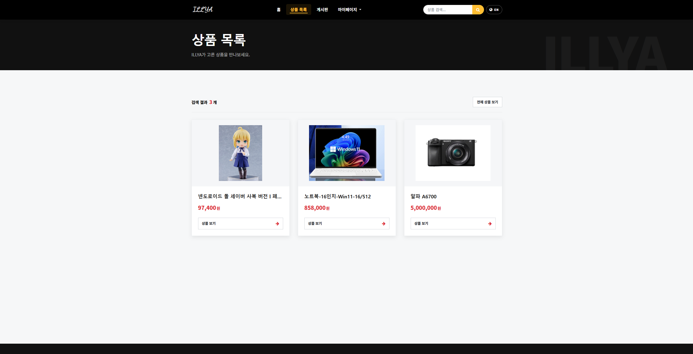

Oracle DB에 저장된 상품을 목록으로 출력하고, 검색어에 맞는 상품을 조회합니다.

### 3. 상품 상세 페이지

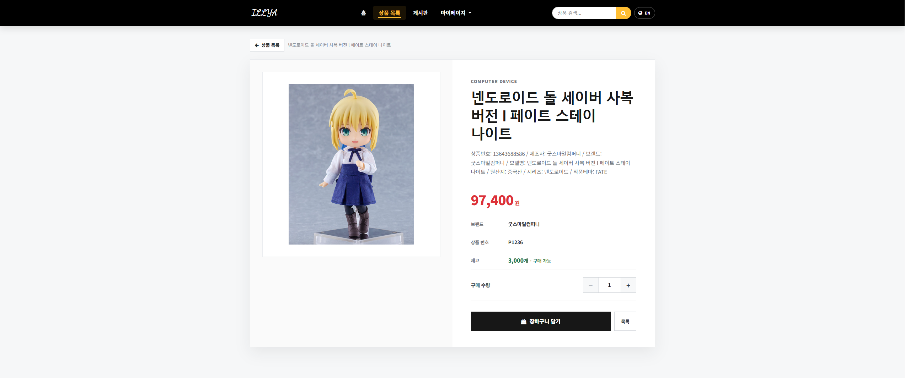

상품 이미지와 가격, 설명, 재고를 확인하고 원하는 수량을 장바구니에 담을 수 있습니다.

### 4. 장바구니

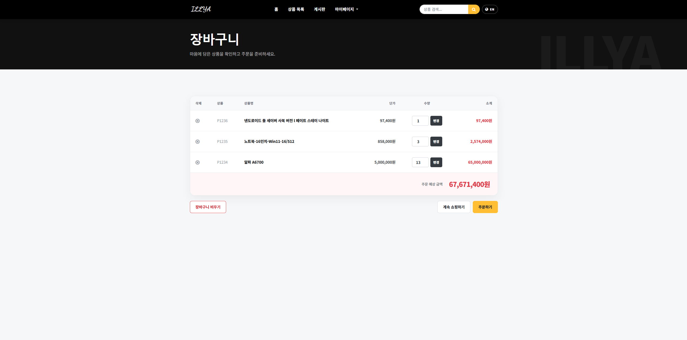

담은 상품의 수량을 변경하거나 삭제하고, 주문할 상품의 합계를 확인할 수 있습니다.

### 5. 주문 확인

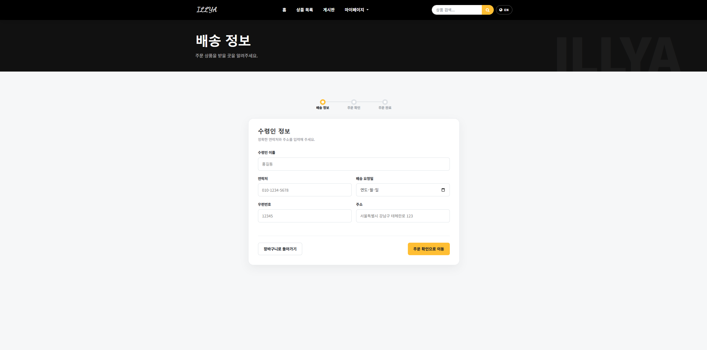

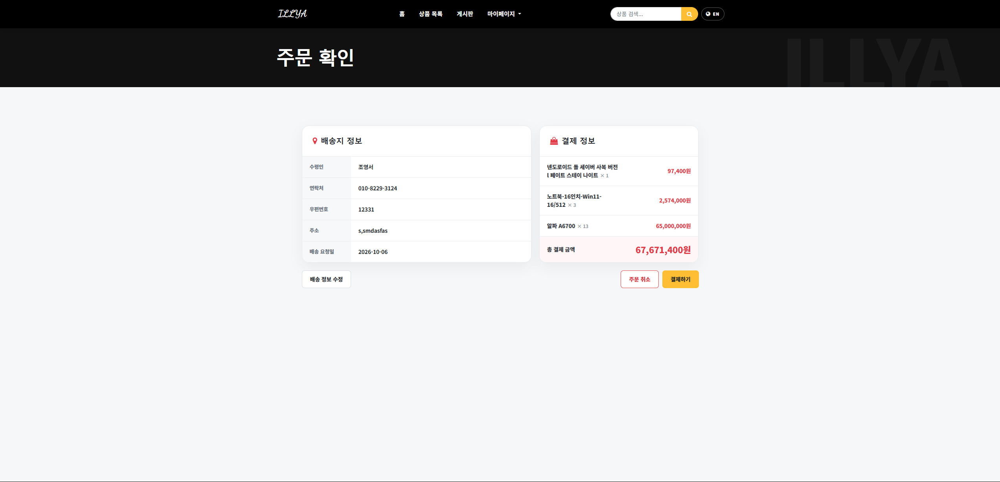

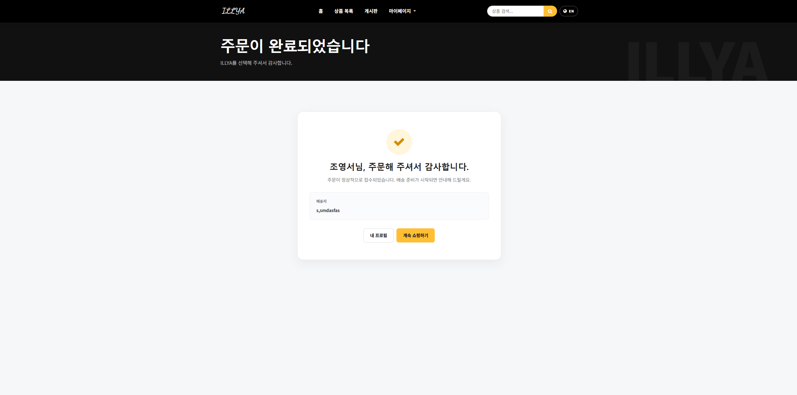

입력한 배송 정보와 주문 상품, 총 주문 금액을 확인합니다.

### 6. 로그인 및 회원가입

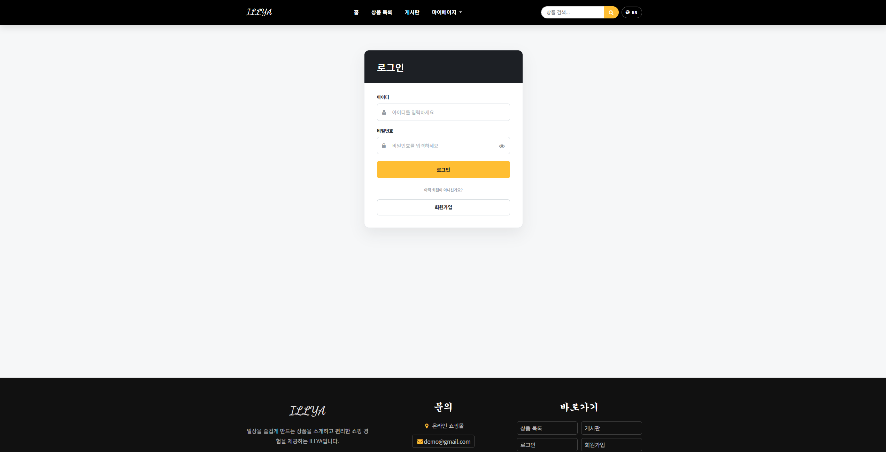

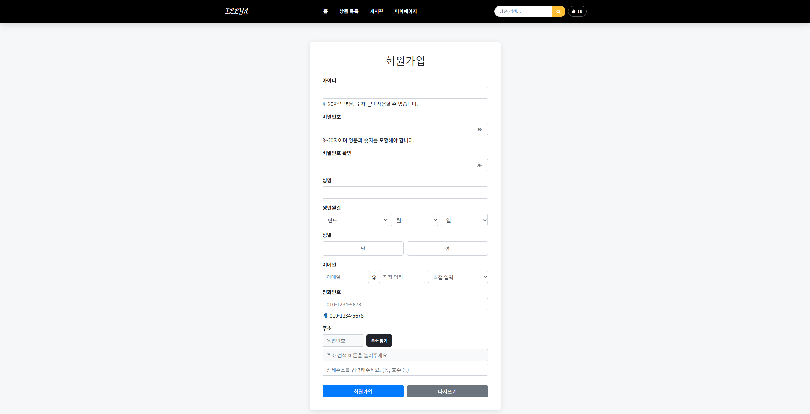

회원 정보를 입력해 가입하고, 등록한 계정으로 로그인할 수 있습니다.

### 7. 관리자 상품 관리

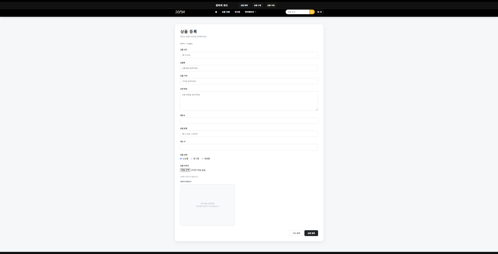

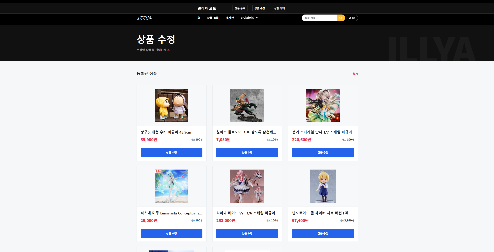

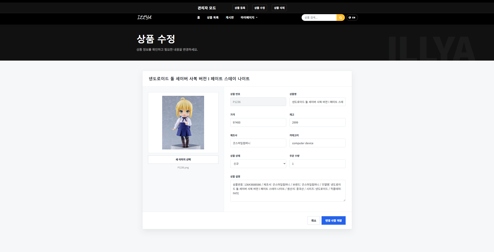

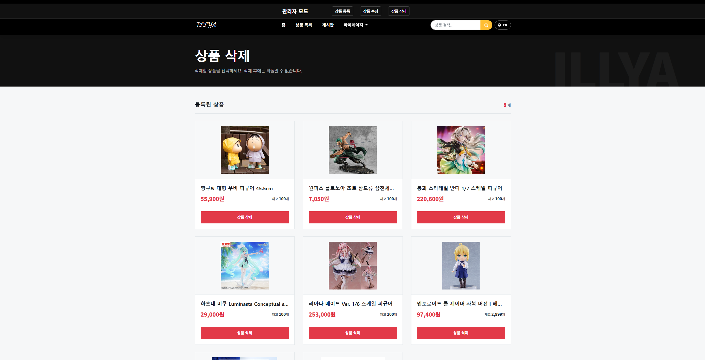

관리자 계정으로 상품 정보를 등록하고 상품 삭제, 이미지와 가격, 재고를 수정할 수 있습니다.

### 8. Q&A 게시판

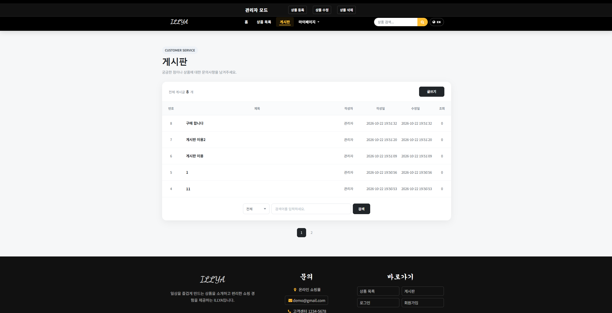

로그인한 사용자는 게시글을 작성할 수 있으며, 본인이 작성한 글을 수정하거나 삭제할 수 있습니다.
